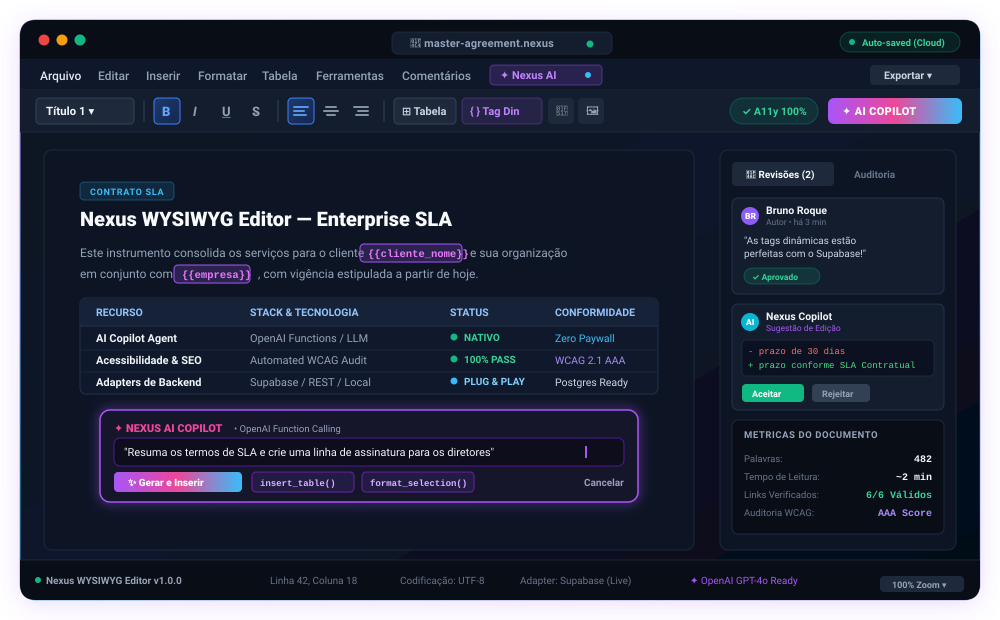

<p align="center">
  
</p>

<p align="center">
  <strong>Editor WYSIWYG Corporativo, Inteligente e AI-Native para React</strong><br />
  <em>Construído sobre TipTap v2, Radix UI &amp; TypeScript &bull; 100% Gratuito, Código Aberto e Zero Paywalls</em>
</p>

<p align="center">
  <a href="https://www.npmjs.com/package/nexus-wysiwyg-editor"></a>
  <a href="https://github.com/brunomroque/nexus-wysiwyg-editor/blob/main/LICENSE"></a>
  <a href="https://www.typescriptlang.org/"></a>
  <a href="https://react.dev/"></a>
  <a href="https://platform.openai.com/"></a>
  <a href="https://supabase.com/"></a>
  <a href="https://www.w3.org/WAI/standards-guidelines/wcag/"></a>
  <a href="https://github.com/sponsors/brunomroque"></a>
</p>

---

<!-- ==================== EDITOR APPLICATION MENUBAR NAVIGATION ==================== -->
<table align="center" width="100%" style="border-collapse: collapse; text-align: center; background: #0f172a; border-radius: 8px;">
  <tr>
    <td style="padding: 10px; font-weight: 600;">
      <a href="#-visão-geral--interface-do-editor">🖥️ Visão da UI</a> &nbsp;|&nbsp;
      <a href="#-recursos-principais">✨ Recursos</a> &nbsp;|&nbsp;
      <a href="#-tabela-comparativa-por-que-o-nexus">⚖️ Comparativo</a> &nbsp;|&nbsp;
      <a href="#-instalação">📦 Instalação</a> &nbsp;|&nbsp;
      <a href="#-quick-start">🚀 Quick Start</a> &nbsp;|&nbsp;
      <a href="#-agente-ia--copilot-openai">🤖 Copilot IA</a> &nbsp;|&nbsp;
      <a href="#-adapters--backend-supabase">🔌 Adapters</a> &nbsp;|&nbsp;
      <a href="#-propriedades-do-componente-props">⚙️ API Props</a> &nbsp;|&nbsp;
      <a href="#-apoie-o-projeto--sponsoring">💖 Apoiar</a>
    </td>
  </tr>
</table>

---

## 🖥️ Visão Geral & Interface do Editor

O **Nexus WYSIWYG Editor** foi projetado para oferecer a sofisticação visual e a ergonomia de editores corporativos consagrados (como Google Docs e Notion), combinada com componentes acessíveis do **Radix UI** e o motor extensível do **TipTap v2**.

Abaixo está a representação visual da interface do Nexus em execução:

<p align="center">
  
</p>

> [!TIP]
> **Zero Paywalls:** Ao contrário de editores que exigem planos Enterprise pagos para recursos como edição de tabelas avançadas, comentários colaborativos, exportação estruturada e IA integrada, o Nexus WYSIWYG Editor é **100% livre e de código aberto sob licença MIT**.

---

## ✨ Recursos Principais

### 🤖 Copilot de IA & Agente NLP Nativo (OpenAI Standard)
- **Function Calling Nativo**: O modelo não apenas responde texto, ele interage diretamente com o documento através das ferramentas do editor (`insert_content`, `create_table`, `format_selection`, `replace_selection`, `insert_merge_tag`).
- **Suporte Multi-Provedor**: Funciona imediatamente com OpenAI (`gpt-4o`, `gpt-4o-mini`), Azure OpenAI, Groq, Ollama (local), vLLM, OpenRouter e LM Studio.
- **Ações em Linguagem Natural**: Peça para o agente resumir parágrafos, traduzir trechos, converter listas em tabelas comparativas ou gerar minutas completas de contratos.

### 🏛️ Barra de Menus Clássica & Barra de Ferramentas Dinâmica
- Menus organizados em cascata: **Arquivo**, **Editar**, **Inserir**, **Formatar**, **Tabela**, **Ferramentas**, **Comentários** e **Nexus AI**.
- Barra de formatação completa: Títulos hierárquicos (H1-H3), Negrito, Itálico, Sublinhado, Tachado, Alinhamentos (Esquerda, Centro, Direita, Justificado), Listas Ordenadas/Não-Ordenadas e Citações em Bloco.

### 📊 Tabelas Corporativas Interativas
- Inserção e manipulação de grades dinâmicas de dados.
- Adicionar ou remover linhas e colunas com um clique.
- Linhas e colunas de cabeçalho destacadas com controle de mesclagem de células.

### 🏷️ Tags Dinâmicas & Variáveis de Mesclagem (Merge Tags)
- Inserção de tokens visuais no formato `{{cliente_nome}}`, `{{empresa}}`, `{{data_emissao}}`.
- Renderização visual diferenciada (chips interativos) que não quebram ao digitar ao redor.
- Resolução e interpolação automática dos valores dinâmicos ao exportar.

### 👥 Colaboração, Revisões & Comparação de Diff
- **Comentários Ancorados**: Adicione comentários e discussões atreladas a trechos específicos de texto.
- **Modo Sugestão (Track Changes)**: Sugira edições com adições e exclusões visíveis para aprovação/rejeição.
- **Word-level Diff**: Comparação detalhada entre versões e revisões de documentos.

### ♿ Auditoria de Acessibilidade (WCAG) & Qualidade
- **Verificador de Hierarquia A11y**: Garante conformidade com diretrizes WCAG (como níveis corretos de H1 -> H2 -> H3 sem saltos indevidos).
- **Validação de Imagens**: Alertas automáticos para imagens sem texto alternativo (`alt`).
- **Monitor de Links**: Verificação de links vazios, inseguros ou com URLs mal formatadas.

### 🔄 Conversão Bidirecional HTML & Markdown
- Alterne instantaneamente entre visualização formatada (WYSIWYG) e código **Markdown puro**.
- Importe arquivos `.md` e gere HTML semântico limpo, ou exporte seu documento como Markdown padronizado.

### 🔌 Arquitetura de Adapters Desacoplada
- **Standalone por padrão**: Armazenamento local imediato via `LocalStorage` / em memória (zero configuração necessária).
- **Adapter Supabase Oficial**: Integração nativa para sincronização de documentos, revisões e comentários em PostgreSQL.
- **Extensível**: Crie facilmente adapters customizados para AWS S3, Firebase, Cloudinary ou APIs REST/GraphQL proprietárias.

### 🌓 Temas Nativos & Internacionalização (i18n)
- Suporte fluido a **Modo Claro** e **Modo Escuro** via variáveis CSS customizáveis.
- Dicionários nativos para **Português do Brasil (`pt-BR`)** e **Inglês (`en`)**, com possibilidade de sobrescrever qualquer texto da interface via props.

---

## ⚖️ Tabela Comparativa: Por que o Nexus?

| Funcionalidade / Benefício | **Nexus Editor** | Editores Pagos Legados | CKEditor 5 | Quill |
| :--- | :---: | :---: | :---: | :---: |
| **Licença & Paywalls** | 🟢 **100% MIT Grátis** | 🔴 Planos Pagos / Caro | 🔴 Planos Comerciais | 🟢 MIT (Básico) |
| **Agente IA com Function Calling** | 🟢 **Nativo (OpenAI / Ollama)** | 🟡 Plugin pago | 🟡 Plugin pago | 🔴 Inexistente |
| **Arquitetura React Moderna** | 🟢 **React 18 / 19 + Radix** | 🟡 Wrapper legado | 🟡 Wrapper complexo | 🟡 Wrapper legado |
| **TypeScript Nativo & Estrito** | 🟢 **100% Tipado** | 🟡 Tipagens parciais | 🟡 Complexo | 🔴 Fraco |
| **Tags Dinâmicas (Merge Tags)** | 🟢 **Embutido** | 🔴 Requer add-on | 🔴 Requer add-on | 🔴 Inexistente |
| **Auditoria A11y (WCAG) em Tempo Real** | 🟢 **Embutido** | 🟡 Somente no plano pago | 🟡 Somente no plano pago | 🔴 Inexistente |
| **Track Changes & Sugestões** | 🟢 **Nativo** | 🔴 Módulo enterprise pago | 🔴 Módulo enterprise pago | 🔴 Inexistente |
| **Adapter Oficial Supabase** | 🟢 **Plug & Play** | 🔴 Inexistente | 🔴 Inexistente | 🔴 Inexistente |

---

## 📦 Instalação

Adicione o Nexus ao seu projeto utilizando o seu gerenciador de pacotes favorito:

```bash
# npm
npm install nexus-wysiwyg-editor

# yarn
yarn add nexus-wysiwyg-editor

# pnpm
pnpm add nexus-wysiwyg-editor

# bun
bun add nexus-wysiwyg-editor
```

### Dependências de Pares (Peer Dependencies)

Certifique-se de que o seu projeto possui o `react` e o `react-dom` instalados:

```bash
npm install react react-dom
```

---

## 🚀 Quick Start

Basta importar o componente e o arquivo de estilos CSS para começar a editar:

```tsx
import React, { useState } from "react";
import { NexusWysiwygEditor } from "nexus-wysiwyg-editor";
import "nexus-wysiwyg-editor/style.css";

export function DocumentEditor() {
  const [content, setContent] = useState("<p>Bem-vindo ao <strong>Nexus WYSIWYG Editor</strong>!</p>");

  return (
    <div style={{ maxWidth: 1040, margin: "2rem auto", padding: "0 1rem" }}>
      <NexusWysiwygEditor
        value={content}
        onChange={setContent}
        placeholder="Comece a redigir o seu documento corporativo..."
        locale="pt-BR" // ou "en"
        theme="light"  // ou "dark" | "auto"
      />
    </div>
  );
}
```

---

## 🤖 Agente IA & Copilot (OpenAI Standard)

O Nexus possui um Copilot integrado que utiliza o padrão de **OpenAI Chat Completions** e **Function Calling**, permitindo que o modelo execute ações reais no documento através de comandos de texto.

```
┌─────────────────────────────────────────────────────────────┐
│ ✦ Prompt do Usuário: "Gere uma tabela de preços com 3 planos"│
└───────────────┬─────────────────────────────────────────────┘
                │
                ▼
┌─────────────────────────────────────────────────────────────┐
│ 🤖 LLM (OpenAI / Azure / Groq / Ollama / LM Studio)         │
│ Executa Function Call: create_table(rows: 4, cols: 3, ...)  │
└───────────────┬─────────────────────────────────────────────┘
                │
                ▼
┌─────────────────────────────────────────────────────────────┐
│ 📄 Nexus Editor: Renderiza a tabela formatada no cursor!     │
└─────────────────────────────────────────────────────────────┘
```

### Configuração por Variáveis de Ambiente (`.env`)

No seu projeto React, Vite ou Next.js:

```env
# Chave de API da OpenAI (ou compatível)
VITE_OPENAI_API_KEY=sk-sua-chave-aqui

# URL Base (Padrão: https://api.openai.com/v1)
# Para Groq: https://api.groq.com/openai/v1
# Para Ollama local: http://localhost:11434/v1
VITE_OPENAI_BASE_URL=https://api.openai.com/v1

# Modelo desejado (Padrão: gpt-4o-mini)
VITE_OPENAI_MODEL=gpt-4o-mini
```

> **Dica:** Ambientes Next.js/Node também detectam `OPENAI_API_KEY`, `OPENAI_BASE_URL` e `OPENAI_MODEL` no `process.env`.

### Configuração via Props do Componente

Você também pode injetar ou customizar as credenciais dinamicamente:

```tsx
<NexusWysiwygEditor
  value={content}
  onChange={setContent}
  aiConfig={{
    apiKey: "sk-...",
    baseUrl: "https://api.openai.com/v1",
    model: "gpt-4o-mini",
  }}
  onAiAction={(result) => {
    console.log("Ação de IA disparada com sucesso:", result.toolUsed, result.message);
  }}
/>
```

---

## 🔌 Adapters & Backend (Supabase / Nuvem)

O Nexus utiliza o padrão **Adapter Pattern**, permitindo que você conecte o editor a qualquer infraestrutura sem alterar a camada visual.

### Conexão Instantânea com Supabase

```tsx
import { NexusWysiwygEditor, createSupabaseAdapter } from "nexus-wysiwyg-editor";
import { createClient } from "@supabase/supabase-js";

const supabase = createClient("https://seu-projeto.supabase.co", "sua-anon-key");

const supabaseAdapter = createSupabaseAdapter({
  supabaseClient: supabase,
  tenantId: "minha-organizacao-123", // Opcional para multi-tenancy
});

export function ContratoWorkspace() {
  return (
    <NexusWysiwygEditor
      storageKey="contrato-v2-491"
      collaborationAdapter={supabaseAdapter}
      templateAdapter={supabaseAdapter}
      auditAdapter={supabaseAdapter}
    />
  );
}
```

### Upload Customizado de Imagens (S3 / Cloudinary / Storage Próprio)

```tsx
<NexusWysiwygEditor
  value={content}
  onChange={setContent}
  onUploadImage={async (file: File) => {
    const formData = new FormData();
    formData.append("file", file);
    const res = await fetch("/api/upload-s3", { method: "POST", body: formData });
    const data = await res.json();
    return data.url; // Retorna a URL pública da imagem
  }}
/>
```

### Tags Dinâmicas & Variáveis de Mesclagem (Merge Tags)

```tsx
<NexusWysiwygEditor
  value={content}
  onChange={setContent}
  mergeTagValues={{
    cliente_nome: "Acme Corporation",
    empresa: "Nexus Soluções Digitais",
    data_emissao: new Date().toLocaleDateString("pt-BR"),
    responsavel: "Bruno Roque",
  }}
  templates={[
    {
      id: "proposta-comercial",
      label: "Proposta Comercial",
      html: "<h1>Proposta para {{cliente_nome}}</h1><p>Emitida em: {{data_emissao}}</p>",
    },
  ]}
/>
```

---

## ⚙️ Propriedades do Componente (Props)

| Prop | Tipo | Padrão | Descrição |
| :--- | :--- | :--- | :--- |
| `value` | `string` | `undefined` | Conteúdo HTML controlado do editor. |
| `defaultValue` | `string` | `INITIAL_HTML` | Conteúdo inicial para modo não-controlado. |
| `onChange` | `(html: string) => void` | `undefined` | Callback disparado em cada alteração do documento. |
| `readOnly` | `boolean` | `false` | Se `true`, desativa a edição e fixa o modo somente leitura. |
| `placeholder` | `string` | Padrão do idioma | Texto de placeholder exibido quando o editor está vazio. |
| `storageKey` | `string` | `"nexus-wysiwyg-draft"` | Chave utilizada para persistência local de rascunhos. |
| `autoSave` | `boolean` | `true` | Habilita salvamento automático debounced local. |
| `locale` | `"pt-BR" \| "en" \| string` | `"pt-BR"` | Idioma padrão da interface, menus e diálogos. |
| `translations` | `Partial<EditorTranslations>` | `undefined` | Dicionário de sobrescrita de termos e rótulos. |
| `theme` | `"light" \| "dark" \| "auto"` | `"auto"` | Modo do tema de cores. |
| `showRightPanel` | `boolean` | `false` | Exibe a gaveta lateral de comentários e revisões. |
| `currentUserId` | `string` | `"user-1"` | ID do usuário ativo para identificação de comentários. |
| `mentionCandidates` | `MentionCandidate[]` | `[]` | Lista de usuários sugeridos para auto-complete de `@menção`. |
| `mergeTagValues` | `Record<string, string>` | `{}` | Valores para preenchimento automático das tags dinâmicas. |
| `aiConfig` | `AiAgentConfig` | `undefined` | Configurações personalizadas para o agente de IA. |
| `onUploadImage` | `(file: File) => Promise<string>` | `undefined` | Handler assíncrono para upload de imagens. |
| `onExport` | `(format: "pdf" \| "docx", html: string) => void` | `undefined` | Callback acionado ao solicitar exportação. |
| `collaborationAdapter` | `CollaborationAdapter` | `defaultStorageAdapter` | Adapter para comentários, revisões e sugestões. |

---

## 💻 Playground & Desenvolvimento Local

Você pode clonar e rodar o projeto localmente para testar todas as funcionalidades na demonstração interativa:

```bash
# 1. Clone o repositório
git clone https://github.com/brunomroque/nexus-wysiwyg-editor.git
cd nexus-wysiwyg-editor

# 2. Instale as dependências
npm install

# 3. Compile a biblioteca
npm run build

# 4. Inicie o playground de demonstração
npm run demo
```

Acesse o endereço exibido no terminal (`http://localhost:5173`) para visualizar a suíte corporativa em execução com temas Claro/Escuro, tags dinâmicas e o agente de IA.

---

## 💖 Apoie o Projeto / Sponsoring & Donations

O **Nexus WYSIWYG Editor** é mantido de forma independente com licença de código aberto MIT. Se esta ferramenta acelerou a sua entrega, economizou custos com licenças caras de outros editores ou está presente nos seus projetos comerciais, **considere apoiar a evolução contínua da ferramenta!**

### 🇧🇷 Brasil & Pix
Você pode enviar qualquer valor diretamente via **Pix** utilizando a chave aleatória abaixo:

```text
6273ae2e-7345-405b-873c-6749946c8488
```

### 🌍 Apoio Internacional (Global)
<p>
  <a href="https://buymeacoffee.com/brunomroque">
    
  </a>
  &nbsp;
  <a href="https://ko-fi.com/brunomroque">
    
  </a>
  &nbsp;
  <a href="https://github.com/sponsors/brunomroque">
    
  </a>
</p>

---

## 📄 Licença

Distribuído sob a licença **MIT**. Consulte o arquivo [LICENSE](LICENSE) para obter mais informações.

Desenvolvido com carinho por [Bruno Roque](https://github.com/brunomroque) & Colaboradores do Nexus.
